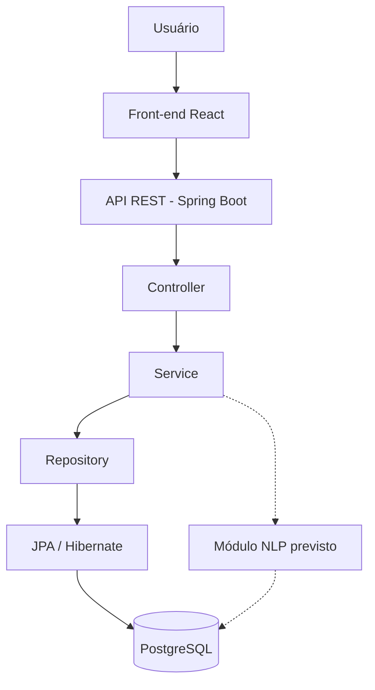
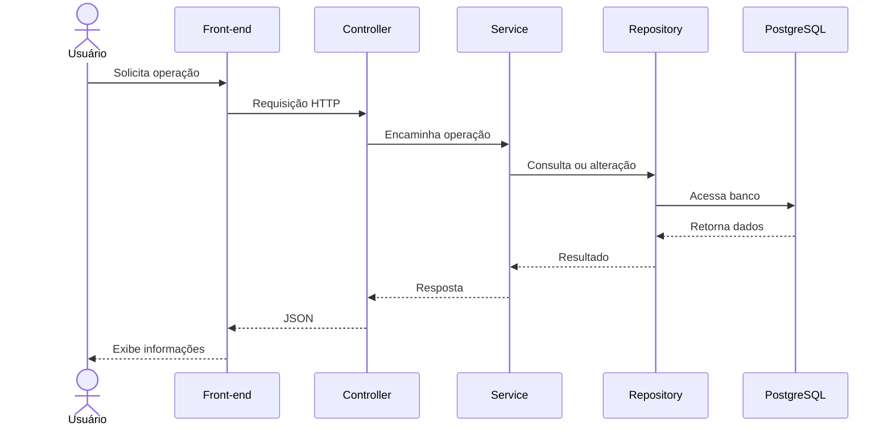

# 🚗 Easy Manager

## Sistema de Análise de Feedbacks e Indicadores Gerenciais para Estacionamentos

**Projeto Integrador IV — Engenharia de Software II**  
**UNITAU — 2026**  
**Orientação:** Prof. Marcio Moraes e Prof. Dawilmar  
**Autoras:** Daphne Almeida e Maria Fernanda Malaquias  
**Produto/cliente de referência:** EstacionaFácil

---

## 📋 1. Sobre o Projeto

O **Easy Manager** é uma aplicação web desenvolvida com o objetivo de centralizar e organizar informações gerenciais de empresas do segmento de estacionamentos, tendo como referência o contexto da EstacionaFácil.

A proposta principal consiste em reunir avaliações de clientes, informações operacionais, dados financeiros e indicadores de desempenho em um único ambiente.

Um dos diferenciais planejados para o sistema é a utilização de técnicas de **Processamento de Linguagem Natural (NLP)** para analisar comentários de clientes, identificar sentimentos e reconhecer categorias de serviços, como atendimento, limpeza, segurança, tempo de espera e preço.

Essas informações podem ser utilizadas para gerar indicadores gerenciais, facilitando a identificação de problemas recorrentes e apoiando a tomada de decisões.

O projeto é desenvolvido como um MVP acadêmico, com arquitetura modular e possibilidade de expansão futura.

**Estágio atual:** o projeto possui estrutura de Front-end, Back-end e banco de dados em desenvolvimento. Algumas interfaces e estruturas de API já foram desenvolvidas, enquanto integrações, autenticação, validações e funcionalidades específicas continuam em implementação.

---

## 🎯 2. Objetivos

- Centralizar avaliações de clientes em uma única base de dados.
- Organizar informações operacionais e administrativas.
- Permitir a consulta de indicadores de satisfação.
- Classificar comentários por sentimento e categoria por meio de NLP.
- Facilitar o acompanhamento do desempenho dos serviços.
- Organizar informações financeiras.
- Gerenciar informações de funcionários.
- Apoiar decisões gerenciais por meio de dados.
- Desenvolver uma aplicação modular e de fácil manutenção.
- Aplicar conceitos de Engenharia de Software durante todo o desenvolvimento.

---

## 👤 3. Público-alvo e Atores

| Ator | Responsabilidade |
|---|---|
| Empresa | Organização que utiliza o sistema para acompanhar seus dados e serviços |
| Gestor / Diretor Operacional | Consulta indicadores, acompanha avaliações e toma decisões |
| Administrador | Gerencia usuários e configurações gerais |
| Funcionário | Participa dos processos operacionais conforme suas permissões |
| Cliente | Fornece avaliações e comentários sobre os serviços |
| Sistema de análise | Processa automaticamente os comentários por meio do módulo de NLP |

O projeto prevê diferentes níveis de acesso, considerando papéis como `GESTOR` e `ADMINISTRADOR`.

---

## ✨ 4. Funcionalidades e Módulos

### 4.1 Central de Empresas

- Organização das empresas cadastradas.
- Acesso aos módulos de cada empresa.
- Estrutura de navegação por empresa selecionada.

### 4.2 Dashboard Gerencial

- Visualização de indicadores.
- Gráficos de desempenho.
- Indicadores de satisfação dos clientes.
- Informações operacionais e financeiras.
- Acompanhamento de evolução dos resultados.

### 4.3 Módulo de Avaliações

- Registro de avaliações.
- Consulta de notas e comentários.
- Organização de feedbacks.
- Estrutura para importação de avaliações de diferentes canais.

### 4.4 Módulo de NLP

- Classificação de sentimentos.
- Identificação de comentários positivos, neutros e negativos.
- Identificação de categorias de serviço.
- Análise de problemas recorrentes.
- Apoio à geração de indicadores de satisfação.

**Observação:** a integração do processamento NLP é uma funcionalidade prevista e deve ser considerada concluída somente após sua implementação e validação.

### 4.5 Módulo Operacional

- Organização de informações de clientes.
- Gerenciamento de veículos.
- Organização de estadias.
- Acompanhamento de atividades operacionais.

### 4.6 Módulo Financeiro

- Organização de pagamentos.
- Registro de despesas.
- Acompanhamento de informações financeiras.
- Apoio à visualização de indicadores.

### 4.7 Módulo de Funcionários

- Organização dos dados dos funcionários.
- Gerenciamento de informações da equipe.
- Estrutura para acompanhamento de atividades.

### 4.8 Relatórios e Alertas

- Consolidação de informações gerenciais.
- Organização de indicadores.
- Previsão de alertas quando determinados indicadores ultrapassarem limites configurados.

---

## 📋 5. Engenharia de Requisitos

Os requisitos de software representam as necessidades e condições que o sistema deve atender.

### 5.1 Requisitos Funcionais (RF)

- **RF01:** Permitir o gerenciamento de empresas.
- **RF02:** Permitir o registro e a consulta de avaliações.
- **RF03:** Permitir a organização de informações operacionais.
- **RF04:** Permitir o gerenciamento de funcionários.
- **RF05:** Permitir a organização de informações financeiras.
- **RF06:** Permitir a visualização de indicadores gerenciais.
- **RF07:** Prever a classificação de avaliações por sentimento e categoria.
- **RF08:** Prever a configuração de alertas gerenciais.
- **RF09:** Prever o gerenciamento de usuários e permissões.

### 5.2 Requisitos Não Funcionais (RNF)

- **RNF01 — Usabilidade:** a interface deve ser compreensível e organizada.
- **RNF02 — Manutenibilidade:** o código deve possuir organização modular.
- **RNF03 — Integridade:** os dados devem respeitar relacionamentos e restrições.
- **RNF04 — Segurança:** o sistema deve considerar autenticação e autorização.
- **RNF05 — Desempenho:** as operações devem apresentar tempo de resposta adequado.
- **RNF06 — Evolução:** a arquitetura deve permitir novas funcionalidades e integrações.

---

## 🏗️ 6. Arquitetura do Sistema

O Easy Manager utiliza uma arquitetura cliente-servidor, separando a interface, o processamento das regras de negócio e o armazenamento de dados.

### 6.1 Visão Geral



### 6.2 Camadas da Aplicação

| Camada | Responsabilidade |
|---|---|
| Front-end | Interface e interação com o usuário |
| Controller | Recebimento das requisições HTTP |
| Service | Processamento das regras de negócio |
| Repository | Acesso e persistência dos dados |
| Entity / Model | Representação das entidades do sistema |
| DTO | Transferência de dados entre componentes |
| Banco de Dados | Armazenamento persistente |

### 6.3 Benefícios da Arquitetura em Camadas

- Separação de responsabilidades.
- Facilidade de manutenção.
- Melhor organização do código.
- Reutilização de componentes.
- Facilidade para realizar testes.
- Redução do acoplamento entre partes do sistema.

O Easy Manager utiliza uma estrutura modular. Não se caracteriza como uma arquitetura de microsserviços na implementação conhecida.

---

## 🔄 7. Fluxo de Comunicação

A comunicação entre Front-end e Back-end ocorre por meio de requisições HTTP, utilizando uma API REST e dados em JSON.



### Exemplo de funcionamento

1. O usuário acessa uma funcionalidade.
2. O Front-end envia uma requisição à API.
3. O Controller recebe a solicitação.
4. O Service processa a operação.
5. O Repository realiza o acesso aos dados.
6. O PostgreSQL retorna as informações.
7. O Back-end envia a resposta.
8. O Front-end apresenta o resultado.

---

## 🗄️ 8. Banco de Dados

O Easy Manager utiliza o **PostgreSQL** como sistema gerenciador de banco de dados relacional.

A estrutura utiliza tabelas, chaves primárias, chaves estrangeiras, relacionamentos e restrições de integridade.

### 8.1 Principais Entidades

| Entidade | Descrição |
|---|---|
| empresa | Informações das empresas |
| usuario | Dados dos usuários |
| unidade | Unidades vinculadas às empresas |
| cargo | Cargos e funções |
| permissao | Permissões de acesso |
| cargo_permissao | Relacionamento entre cargos e permissões |
| usuario_empresa | Relacionamento entre usuários e empresas |
| funcionario | Informações dos funcionários |
| cliente | Informações dos clientes |
| veiculo | Informações dos veículos |
| estadia | Registros de estadias |
| avaliacao | Notas e comentários |
| pagamento | Registros de pagamentos |
| despesa | Registros de despesas |
| atividade_funcionario | Atividades dos funcionários |

### 8.2 Conceitos de Banco de Dados

**Chave Primária (PK):** identifica unicamente cada registro de uma tabela.

**Chave Estrangeira (FK):** estabelece relacionamento entre tabelas.

**Cardinalidade:** representa a quantidade de registros relacionados.

- 1:1 — um para um.
- 1:N — um para muitos.
- N:N — muitos para muitos.

**Normalização:** organiza os dados para reduzir redundâncias e evitar inconsistências.

### 8.3 Tecnologias de Persistência

- **JPA:** especificação Java para persistência de dados.
- **Hibernate:** implementação ORM que realiza o mapeamento entre objetos Java e tabelas relacionais.
- **Liquibase:** controla alterações estruturais do banco por meio de changelogs e changesets.
- **HikariCP:** gerencia o pool de conexões JDBC.
- **Maven:** gerencia dependências e build do Back-end.

---

## 🌐 9. API REST

A API REST é responsável pela comunicação entre Front-end e Back-end.

Ela utiliza o protocolo HTTP e o formato JSON para transmitir informações.

### 9.1 Métodos HTTP

| Método | Finalidade |
|---|---|
| GET | Consultar informações |
| POST | Criar ou enviar informações |
| PUT | Atualizar um recurso |
| PATCH | Atualizar parcialmente um recurso |
| DELETE | Remover um recurso |

### 9.2 Endpoints Conhecidos

| Endpoint | Finalidade |
|---|---|
| `/api/empresas` | Consulta de empresas |
| `/api/avaliacoes` | Operações relacionadas às avaliações |
| `/api/usuarios` | Operações relacionadas aos usuários |

Durante o desenvolvimento, o endpoint `GET /api/empresas` apresentou resposta HTTP 200. O endpoint de avaliações passou por ajustes de integração.

A disponibilidade de cada operação deve ser confirmada no código atual dos Controllers.

### 9.3 JSON

Exemplo de estrutura JSON:

```json
{
  "nome": "Empresa Exemplo",
  "cnpj": "00000000000000"
}
```

### 9.4 CORS

CORS é um mecanismo de segurança dos navegadores que controla requisições entre origens diferentes.

Durante o desenvolvimento:

- Front-end: `http://localhost:5173`
- Back-end: `http://localhost:8080`

### 9.5 Autenticação e Autorização

- **Autenticação:** verifica a identidade do usuário.
- **Autorização:** determina quais funcionalidades o usuário pode acessar.

A implementação do fluxo de autenticação e controle de acesso estava em desenvolvimento e depuração.

---

## 🧠 10. Processamento de Linguagem Natural (NLP)

O Processamento de Linguagem Natural é uma área da Inteligência Artificial que permite analisar textos escritos em linguagem humana.

No Easy Manager, a proposta é utilizar NLP para analisar avaliações e identificar padrões de satisfação.

### Exemplo

Comentário:

> O atendimento foi excelente, mas demoraram muito para entregar meu carro.

Possível classificação:

- Atendimento: sentimento positivo.
- Tempo de entrega: sentimento negativo.
- Categorias: atendimento e tempo de espera.

### Abordagens Técnicas Consideradas

| Abordagem | Característica |
|---|---|
| Apache OpenNLP / Stanford CoreNLP | Bibliotecas Java para processamento de linguagem |
| API externa de IA | Envia o comentário a um serviço externo para classificação |
| Serviço Python | Serviço especializado em NLP que se comunica com o Back-end Java |

Para o MVP, podem ser avaliadas bibliotecas Java ou uma API externa. Um serviço Python pode ser considerado em uma evolução futura.

### Processamento Síncrono e Assíncrono

**Síncrono:** o processamento ocorre durante a solicitação, de forma direta.

**Assíncrono:** o processamento ocorre posteriormente, por meio de uma fila ou tarefa agendada.

O processamento assíncrono pode ser uma evolução para reduzir o impacto do NLP no tempo de resposta do cadastro de avaliações.

---

## 📐 11. UML e Modelagem

UML significa Unified Modeling Language. É uma linguagem de modelagem utilizada para representar a estrutura, o comportamento e as interações de um sistema.

### Principais Diagramas

| Diagrama | Finalidade |
|---|---|
| Casos de uso | Representa atores e funcionalidades |
| Classes | Representa classes, atributos e relacionamentos |
| Sequência | Representa interações ao longo do tempo |
| Atividades | Representa fluxos de ações e decisões |
| Estados | Representa estados e transições de objetos |

### Aplicação no Easy Manager

Os diagramas podem representar:

- Interação entre gestor e sistema.
- Gerenciamento de avaliações.
- Estrutura das entidades.
- Comunicação entre Front-end e Back-end.
- Fluxos operacionais.

### Processo de Negócio de Referência

Um fluxo conceitual do contexto de estacionamento pode envolver:

1. Entrada do veículo.
2. Registro da estadia.
3. Acompanhamento operacional.
4. Encerramento da estadia.
5. Pagamento.
6. Avaliação do serviço.
7. Análise gerencial dos resultados.

Esse fluxo representa o contexto do negócio e não significa que todas as etapas estejam automatizadas e integradas no sistema.

---

## 🧪 12. Testes e Qualidade de Software

A qualidade de software está relacionada à capacidade de um sistema atender aos requisitos e apresentar características adequadas de funcionamento.

Entre os principais atributos estão:

- Usabilidade.
- Desempenho.
- Segurança.
- Confiabilidade.
- Manutenibilidade.
- Compatibilidade.
- Adequação funcional.

### 12.1 Tipos de Testes

| Tipo | Objetivo |
|---|---|
| Unitário | Testar unidades isoladamente |
| Integração | Testar a comunicação entre componentes |
| Sistema | Testar o sistema como um todo |
| Aceitação | Verificar atendimento aos critérios definidos |
| Regressão | Verificar se alterações não causaram novas falhas |
| Funcional | Validar funcionalidades do sistema |

### 12.2 Cenários de Teste

- Consultar empresas.
- Registrar avaliações.
- Consultar avaliações.
- Validar dados obrigatórios.
- Testar entradas inválidas.
- Verificar persistência no banco.
- Validar comunicação entre Front-end e Back-end.
- Testar autenticação e permissões.
- Verificar consistência dos indicadores.

Os cenários são referências para validação. Sua aprovação depende da execução e do registro dos resultados.

---

## 📈 13. Métricas de Software

As métricas são utilizadas para avaliar o processo de desenvolvimento e a qualidade do produto.

### 13.1 Métricas de Processo

Avaliam o andamento do desenvolvimento:

- Tempo de desenvolvimento de funcionalidades.
- Quantidade de tarefas concluídas.
- Quantidade de tarefas pendentes.
- Tempo de resolução de problemas.
- Volume de retrabalho.
- Evolução das atividades.

### 13.2 Métricas de Produto

Avaliam características do software:

- Quantidade de defeitos.
- Tempo de resposta.
- Taxa de aprovação dos testes.
- Cobertura de requisitos.
- Usabilidade.
- Confiabilidade.
- Desempenho.

### Fórmulas

**Taxa de aprovação dos testes:**

(Total de testes aprovados / Total de testes executados) × 100

**Cobertura de requisitos:**

(Requisitos verificados / Total de requisitos definidos) × 100

Essas métricas devem ser calculadas a partir de dados realmente coletados.

---

## 🛠️ 14. Tecnologias Utilizadas

### Front-end

| Tecnologia | Aplicação |
|---|---|
| React | Construção de interfaces |
| TypeScript | Tipagem estática |
| Material UI | Componentes visuais |
| React Router | Navegação |
| Recharts | Gráficos |
| Lucide React | Ícones |
| Vite | Desenvolvimento e build |
| Node.js | Ambiente das ferramentas |
| npm | Gerenciamento de dependências |

### Back-end

| Tecnologia | Aplicação |
|---|---|
| Java 25 | Linguagem de programação |
| Spring Boot | Framework principal |
| Spring Web | API REST |
| Spring Data JPA | Persistência |
| Hibernate | ORM |
| Maven | Dependências e build |
| Liquibase | Migrações do banco |

### Banco de Dados

- PostgreSQL.
- SQL.

### Ferramentas

- Visual Studio Code.
- IntelliJ IDEA.
- Git.
- GitHub.
- PostgreSQL.
- DevTools do navegador.

---

## 📁 15. Estrutura do Projeto

```text
Easy-Manager/
│
├── frontend/
│   ├── public/
│   ├── src/
│   │   ├── components/
│   │   ├── pages/
│   │   ├── layouts/
│   │   ├── assets/
│   │   └── ...
│   ├── package.json
│   └── vite.config.ts
│
├── backend/
│   ├── src/
│   │   └── main/
│   │       ├── java/
│   │       │   └── com/easymanager/
│   │       │       ├── controller/
│   │       │       ├── service/
│   │       │       ├── repository/
│   │       │       ├── model/
│   │       │       ├── dto/
│   │       │       └── ...
│   │       │
│   │       └── resources/
│   │           ├── application.properties
│   │           └── db/
│   │               └── changelog/
│   │
│   └── pom.xml
│
├── docs/
│
└── README.md
```

---

## 🚀 16. Instalação e Execução

### Pré-requisitos

- Java JDK 25, conforme o ambiente de desenvolvimento.
- Maven.
- Node.js.
- npm.
- PostgreSQL.
- Git.

### 16.1 Clonar o Repositório

```bash
git clone URL_DO_REPOSITORIO
cd Easy-Manager
```

Substitua `URL_DO_REPOSITORIO` pelo endereço real do GitHub.

### 16.2 Criar o Banco de Dados

No PostgreSQL:

```sql
CREATE DATABASE easy_manager;
```

### 16.3 Configurar o Back-end

Abra:

```text
backend/src/main/resources/application.properties
```

Configure a conexão com o banco:

```properties
spring.datasource.url=jdbc:postgresql://localhost:5432/easy_manager
spring.datasource.username=postgres
spring.datasource.password=SUA_SENHA

server.port=8080
```

As propriedades de JPA e Liquibase devem permanecer compatíveis com os changelogs e os mapeamentos das entidades existentes.

Não publique senhas ou credenciais no repositório.

### 16.4 Executar o Back-end

```bash
cd backend
mvn spring-boot:run
```

Endereço:

```text
http://localhost:8080
```

### 16.5 Instalar as Dependências do Front-end

Em outro terminal:

```bash
cd frontend
npm install
```

### 16.6 Executar o Front-end

```bash
npm run dev
```

Endereço:

```text
http://localhost:5173
```

Para utilizar a aplicação integrada, o banco de dados, o Back-end e o Front-end devem estar configurados e em execução.

---

## 🗺️ 17. Roadmap

As etapas abaixo representam possibilidades de evolução do projeto:

- [ ] Finalizar a integração dos módulos com a API.
- [ ] Validar a persistência de dados nos fluxos necessários.
- [ ] Finalizar autenticação e autorização.
- [ ] Implementar e validar classificação de sentimentos por NLP.
- [ ] Consolidar indicadores com dados persistidos.
- [ ] Avaliar processamento assíncrono de NLP.
- [ ] Avaliar importação de avaliações por CSV.
- [ ] Implementar alertas gerenciais.
- [ ] Avaliar integração com aplicativos de reservas.
- [ ] Avaliar integração com sistemas de pagamento.
- [ ] Avaliar novos canais de coleta de feedbacks.

---

## 📌 18. Status Atual do Projeto

O Easy Manager encontra-se em desenvolvimento.

| Área | Situação registrada |
|---|---|
| Estrutura do Front-end | Desenvolvida |
| Interfaces e navegação | Desenvolvidas, com ajustes |
| Estrutura do Back-end | Desenvolvida |
| API REST | Implementada parcialmente; integração em validação |
| Banco PostgreSQL | Estruturado |
| Persistência | Em integração e validação |
| Dashboard | Interface desenvolvida; integração dos indicadores a validar |
| Avaliações | Interface desenvolvida; integração em ajustes |
| Operacional | Em desenvolvimento |
| Financeiro | Em desenvolvimento |
| Funcionários | Em desenvolvimento |
| Autenticação | Em desenvolvimento e depuração |
| NLP | Proposta de implementação/evolução |
| Testes | Verificações e depuração em andamento |

**Importante para a avaliação:** é necessário diferenciar funcionalidades implementadas, integradas, em desenvolvimento e propostas.

- **Implementado:** existe no código.
- **Integrado:** comunica-se com as demais partes e utiliza os dados esperados.
- **Em desenvolvimento:** está parcialmente implementado ou em ajustes.
- **Proposto:** faz parte do planejamento, mas ainda não foi implementado.

---

## 👥 19. Equipe

| Nome | Participação |
|---|---|
| Daphne Almeida | Desenvolvimento |
| Maria Fernanda Malaquias | Desenvolvimento |

**Curso:** Sistemas de Informação — UNITAU  
**Projeto:** Projeto Integrador IV — Engenharia de Software II  
**Ano:** 2026

**Orientação:** Prof. Marcio Moraes e Prof. Dawilmar.

---

## 📄 20. Licença e Contexto Acadêmico

Projeto acadêmico desenvolvido para fins educacionais no âmbito do Projeto Integrador IV / Engenharia de Software II da Universidade de Taubaté (UNITAU).

---

**Easy Manager — centralização de feedbacks e indicadores para apoiar a gestão de estacionamentos.**
